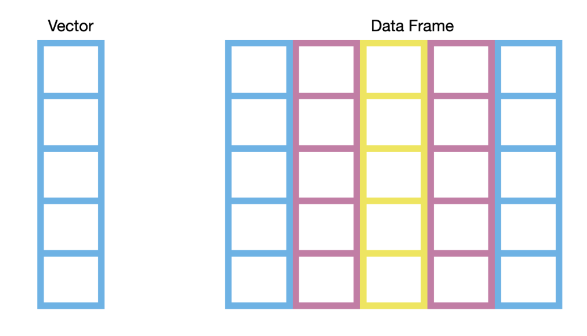
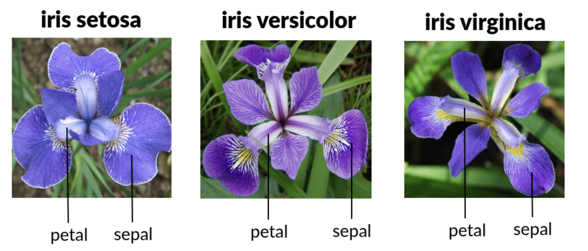
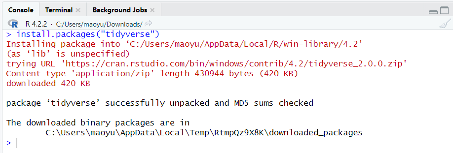
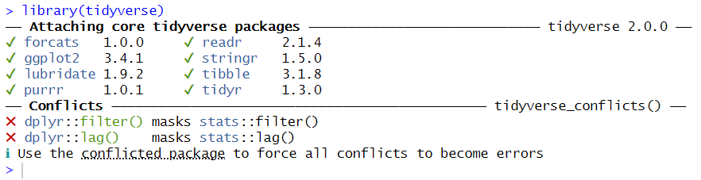
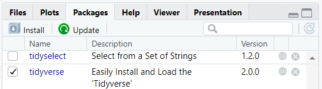
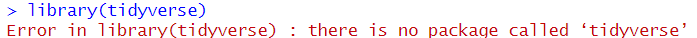

# **Concepts and Basic Syntax**

An R script you can use to follow-along with this lesson can be downloaded [here](https://github.com/ubc-library-rc/IntroR/blob/main/scripts/Intro_R_Script_Blank.R).

## 1. Basic R Operators and Functions

The most basic thing you can do in R is use it as a calculator. Just like a regular calculator, R can reconize arithmetic operators such as addition (+), subtraction (-), multiplication (*), and division (/). Type `?Arithmetic` into the console to read the R document in the help tab.

**Example: R as a calculator**
``` r
2 + 2
10 * 5
12/3
```
R can also reconize logical operators which can be used to perform logical operations. Examples include: equality (==), inequality (!=), greater than (>), greater or equal to (>=).  Type `?base::Logic` into the console to read the R document in the help tab. 

**Example: Comparing things**
``` r
78 < 100
7 == 30 
```

R can use mathamatical functions. You can call a function by typing the function name followed by a set of parentheses. 

**Example: Mathamatical functions**
``` r
#square root
sqrt(16)

#sin
sin(6)
```

In R, a **function** performs a specific task and can be called or executed by the user. Functions are an essential part of R programming because they allow you to automate tasks and reuse code. As a R user, you can rely on functions heavily.

Functions normally require "arguments", which go inside the parentheses. The argument of the sqrt function is the number we want to calculate the square root of.

Some functions have more then one argument, for example the round function.

**Example: Rounding**
``` r
#The first argument is the number we want to round (66.66666)
#The second argument is the number of decimal points (0)

round(66.66666, 0)
```

When R is installed, it comes with a default package named `base`, which contains some **built-in functions** that you can use. For example:

| `mean()` \| Calculates the arithmetic mean of a vector of numbers.
| `sd()` \| Calculates the standard deviation of a vector of numbers.
| `str()` \| Displays the structure of an R object.
| `table()` \| Creates a frequency table of a vector or factor.
| `plot()` \| Creates a basic plot of data.

Most functions that you might want to use in R will need to be installed from additional packages, we will discuss how to install packages at the end of this module. 

## 2. Creating a Variable

Variables are used in R to store information. Assignment operators (`<-` and `=`) are used to assign a value to a variable.

**Example: Creating your first variable**
``` r
#we can assign a value of 7 to the a varible called x
x <- 7
```

If we want to see what is stored in a variable we can run it in the console and R will print its value. Variables will also show up in the Environment tab in R-Studio.

Variables can be used to store the output of a mathamatical expression or a function:
``` r
y <- 1/3

z <- sqrt(16)
```

Variables can also be used in a mathematical expression or a function:
``` r
round(y, 2)

x + y
```

Variables can be reassigned. R will only "remember" the most recent value assigned to a variable:
``` r
x #x is equal to 7
x <- 6.5 #reassigning x 
x #x is now equal to 6.5
```

---

## 3. Data Types in R

The information you store in a variable does not have to be numeric. You can store text in a variable, but it must be wrapped in quotation marks:

**Example: Creating character varibles**
``` r
my_name <- "Emma"

weekday <- "Thursday"
```

>**TIP:**
>Variable names can not have spaces in them. Many R users will replace spaces with '_' in variable names.

If we try and use the math opperators to add text variables together we get an error:
``` r
#this gives an error:
my_name + weekday

#so does this:
my_name * 7
```

This is because weekday and my_name are not the right **data type** for mathamatical opperators. All data 
in R has a type. We can use the class() function to discover what data type our variables are.
``` r
class(x) 
#numeric

class(weekday) 
#character
```

There are 5 **data types** in R:

| `Numeric` \| Default numeric type, can be any real number (e.g. 0.5, pi, 45). Also called a Double.
| `Interger` \| Exact whole numbers (e.g., 2, 566)
| `Character` \| Represents text strings. Enclosed in quotes (e.g., "hello", 'world'). 
| `Logical` \| Represents Boolean values (TRUE or FALSE).
| `Complex` \| Used for numbers with imaginary components, you will probably not need to use this!

The type of data that you have will determine what you can do. For example, you can not use mathematical functions on characters, that's why we got an error when we try and add weekday to my_name.

**Example: Using functions with character varibles**

When we tried to add two character variables together, you might have expected R to concatenate the two words together. Although trying to stick two words together with the `+` will result in an error, we can "add" character strings together - we just need to use a function that works with character data.
``` r
last_name <- "Jones"

#we can use the paste0 functions to "stick" character strings together:
full_name <- paste0(my_name, " ", last_name)
full_name
```

> **TIP:**
> If you are getting errors when working with character variables, the first thing to check is that all text is wrapped in quotation marks.

## 4. Data Structures in R

### Vectors

So far we have not done very much that we can't do quickly with a calculator, but what if we want to do something that is more difficult or annoying to calculate? For example, what if we want to add together every number between 525 and 779?

Here we want to start by creating something called a vector. We can create a vector of every number between 525 and 779 using the ":" operator:

``` r
test_vector <- 525:779

test_vector
```

A **vector** is a basic data structure that represents a sequence of values of *the same data type*. Vectors can be made of any data type, but all values in the vector must be the same type.

> **TIP:**
> If you want to create a set of information that inculdes more than one data type you can use a data structure in R called a list, but be aware that many functions and utilities of vectors will not work in the same way for lists.

A vector can be created using the `c()` function, which combines values into a vector. 

**Example: Creating vectors**
``` r
#We can create a vector of character data:
list_of_countries <- c("France", "Egypt", "China", "Iran")

#Numeric vectors do not have to be sequential or in ascending order:
list_of_ages <- c(52, 23, 45, 77)
```

What if we want to grab one specific value something from a vector? What if we want to change one element in the vector?

To access an element in a vector, you can use the operator `[]` and a number inside it indicating the position of the element. For example, to access the second element in `d`, the syntax is `d[2]`. We can use this indexing to pull out a vector value or to reassign it's value

**Example: Indexing vectors**
``` r
colours <- c("green", "yellow", "blue", "red", "darkgreen")

#we can look at the value in the 4th position of the vector
colours[4]

#we can change the value in the second position to "pink"
colours[2] <- "pink"

colours[2]
```

### Data frames

A **data frame** is a two-dimensional tabular data structure that represents a rectangular grid of data, where each row represents an observation and each column represents a variable. Essentially, a data frame is several equal-length vectors - one for each column. The data in each column must be of the same type, while the data in each row can be different types.



[Image Source: Data Structures](https://zief0002.github.io/epsy-5261/01-03-data-structures-in-r.html)


R comes with several **built-in data frames**. These data sets can be useful for learning and practicing data manipulation, analysis, and visualization techniques.

These data sets can be accessed by name in R and can be loaded into memory using the `data()` function. 

We will work woth the `iris` data frame, which contains measurements of the length and width of petals and sepals for three species of iris flowers (setosa, versicolor, and virginica). 


  
[Image Source: CodeSignal](https://codesignal.com/learn/courses/intro-to-unsupervised-machine-learning/lessons/exploring-and-visualizing-the-iris-dataset)

**Example: Loading iris data frame**
``` r
data(iris)
```

To access an element in a data frame, you can use the operator `[]` and two numbers inside it indicating the row and column position of the element. For example, to access the element in the second row and fourth column in `iris`, the syntax is `iris[2, 4]`. You can also access a variable in a data frame with the `$` operator, for example, `iris$Sepal.Length` calls out the `Sepal.Length` variable from `iris` dataset.

**Example: Subsetting iris data**
``` r
# Get one column
iris$Sepal.Length

# Get one row
iris[1, ]

# Get one cell
iris[1, 4]

# Get setosa species only
setosa_only <- iris[iris$Species == "setosa", ]
```

Because each column of a data frame is a vector, we can use functions on columns in the dataframe just like we did on vectors.

**Example: Function of data frame columns**
``` r
#calculate the mean petal width
mean(iris$Petal.Width)

#calculate the sum of petal width
mean(iris$Petal.Width)
```

> **TIP:**
> You can import **foreign data** into R data frames. The beginner-friendly way to do this is to import through the Import Dataset button under Environment on the top right pane.

## 5. Packages

As introduced earlier, R is powerful partially because it is extensible by installing additional packages quickly. In R, a **package** is a collection of functions, data, and documentation.

Packages can be installed using the `install.packages()` function, which downloads the package from a repository (usually cran) and installs it on your system. Once a package is installed, its functions and data can be loaded into the R environment using the `library()` function. You **do not need to install a package repeatedly, but you do need to library it again in order to use it every time when you restart the RStudio.** If you want to use a function from a package without library(), you can use the double colon operator, for example, `dplyr::filter()`, where `dplyr` is the package name, and `filter()` is a function from the package.

The `tidyverse` is a collection of popular R packages for data manipulation and visualization. Use the following commands to install and load the `tidyverse` package:


``` r
install.packages("tidyverse") # Install package
library(tidyverse) # Load package
```

<details>

<summary><u>Click here for outputs</u></summary>

<p><strong>Output 1:</strong></p>



<p>It is likely to get <b>some message in red</b> in the output when you install a package. As long as it says the package is successfully unpacked, you can ignore those message. Go ahead to the next step - load the package.</p>

<p><strong>Output 2:</strong></p>



<p>If you got the same output in the console or find the box for the package checked under the package tab on the bottom right pane, you have successfully loaded the package. The <b>conflits</b> messages in the output indicate that some functions from different packages have the same name. The functions from the currently loaded package will be used as default if you do not specify the package from which the function should be used.</p>



<p>However, if you get the output that says there is no such package, your installation step has unresolved issues. Try update your R and RStudio to the latest version and install again.</p>


:::

**Example: Welcome to the Tidyverse**
Let's subset the iris data frame to test the capabilities of the tidyverse package. Let's keep the setosa species with a sepal length below 5, add a new Sepal Ratio column (length ÷ width), select the columns of interest, and arrange the rows from smallest to largest ratio.

``` r
# Take iris, THEN filter, THEN add a new column, THEN pick columns, THEN sort.

s_below5 <- iris_dataframe %>%
  filter(Species == "setosa", Sepal.Length < 5) %>%      # keep small setosa flowers
  mutate(Sepal.Ratio = round(Sepal.Length / Sepal.Width, 2)) %>%  # create a new variable
  select(Species, Sepal.Length, Sepal.Width, Sepal.Ratio) %>%     # keep columns we care about
  arrange(Sepal.Ratio)                                  # sort smallest Ratio
s_below5
```

## 5. Some Tips and Tricks

### Organization in R

-   Make folders with descriptive names for each new activity you do in R. Keep all your files in there. Think, using a different **working directory** for each project you work on.

-   When you read files into R, give them a name that is distinctive but easy to type out. Also, dataframe names in R can not start with a number, can not have spaces, and can only have the symbols ".", "-", or "_" in them.

### Open up your data!

-   Many hours of pain can be saved by regularly opening up your dataframes to see if they look right. You know what your data are supposed to look like, they are yours after all.

-   Opening up your dataframes lets you see things like:

    -   Are some data missing?

    -   Are some columns that are supposed to be numeric currently characters? \*\* This is a very common problem!

    -   Did my data manipulation work as intended? see <https://ubc-library-rc.github.io/intro_to_tidyverse/>

``` r
# Open up your data with the View() function. Note the CAPITALIZED V!!!!
View(iris)
```
**More Options**
``` r
# Exploring the iris dataset
data(iris)
View(iris)
head(iris)
str(iris)
```

### What to do when you get errors or don't know how to do something

-   Paste the error message into a search engine or ChatGPT.

-   Check that the solution is for the correct R packages, if you know it and that the solution is for R, not for python. The error messages are usually unique, but it's a good habit to get into as your questions will become more complex over time.

-   If you are figuring out how to do something you have never done before, include the package name (if there is one), the letter R (to avoid python solutions coming up in your results), and the data type (e.g. data frame) along with what you want to do. Lets say I want to plot a dot plot of the **mtcars** data to look at the miles per gallon (x variable) and the count of cars with that miles per gallon (y variable), I would search "*ggplot2 dot plot in R".* Try this out for yourself!

<p style="color:grey; font-size:14px; padding-top: 2em">

This page is meant to introduce some core concepts and basic syntax in R. What questions do you have about the terminologies and sytax? Now is a good time for you to share your questions, thoughts and comments.

</p>
